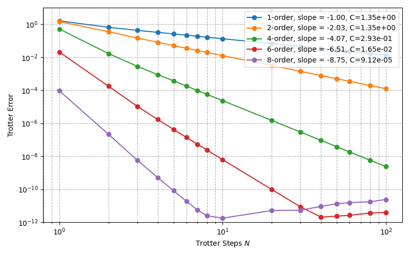
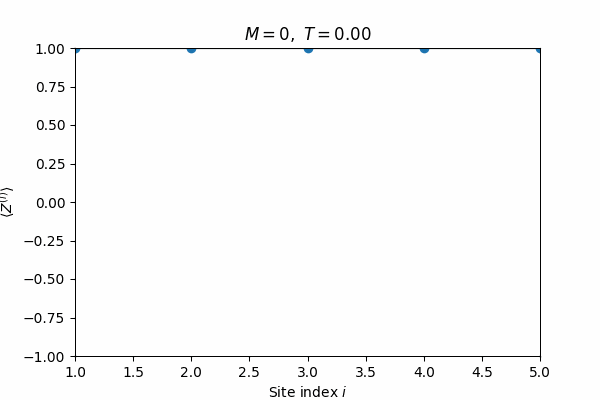

# Hamiltonian + Lindblad simulation

Quantum simulation project from Spring 2025. The full writeup is in [`Paper.pdf`](Paper.pdf).

**`hamiltonian_sim.ipynb`**: Trotterizing the transverse field Ising model and the XXZ chain (5 qubits) using product formulas of order 1, 2, 4, 6 and 8. I looked at how the error scales with the number of Trotter steps N, fit the error constant for each order, and used that to compare which order needs the fewest CNOTs for a given error and time.



**`lindblad_sim.ipynb`**: open system simulation of an XXZ chain where one end gets driven spin up and the other spin down. The dissipation is done with ancilla qubits that get reset every step. The spin profile relaxes to the nonequilibrium steady state:



`runtime_sim.py` is the timing / CNOT counting part pulled out into a script so I could run it in the background.

## Running

```
pip install qiskit qiskit-aer numpy scipy matplotlib networkx
```

then run the notebooks top to bottom. One cell in `hamiltonian_sim.ipynb` uses [qlib](https://github.com/ishaanganti/qlib) to get the exact time evolution.
