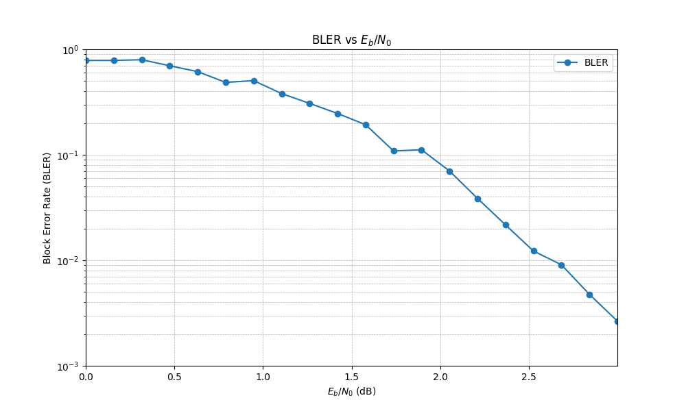

# LDPC + qLDPC codes

Two things in here:

**`LDPC.py`**: a (3,6) regular LDPC code (rate 1/2, 200 info bits, block length 400) built from a protograph, with an iterative belief propagation decoder. It sends codewords through an AWGN channel and measures the block error rate (BLER) vs Eb/N0. Run it with

```
python LDPC.py
```

and it saves the results to an `.npz` and plots them with `Plotting.py`.



**`encoder_decoder_and_noise.ipynb`**: a small quantum LDPC (CSS) code. I build the encoding and syndrome circuits with [stac](https://github.com/abdullahkhalids/stac), add random X/Z errors, simulate it in qiskit, and decode the syndrome with BP+OSD (from the [`ldpc`](https://github.com/quantumgizmos/ldpc) package). Then I plot the logical error rate vs the physical error rate.

```
pip install numpy matplotlib qiskit qiskit-aer stac ldpc
```
